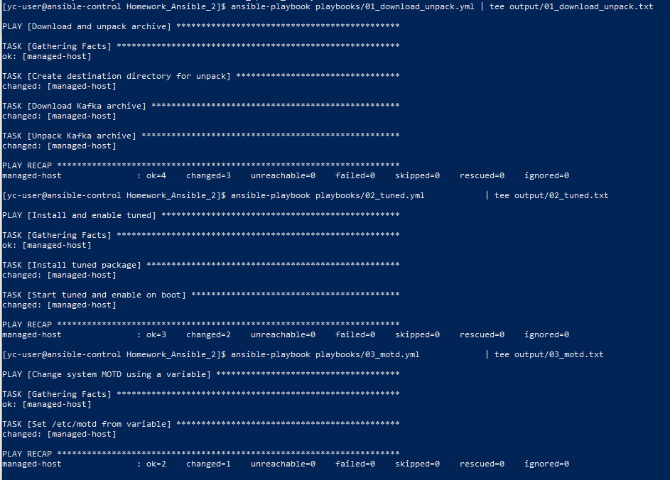
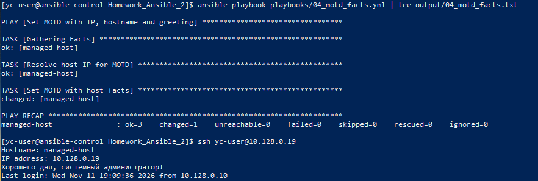
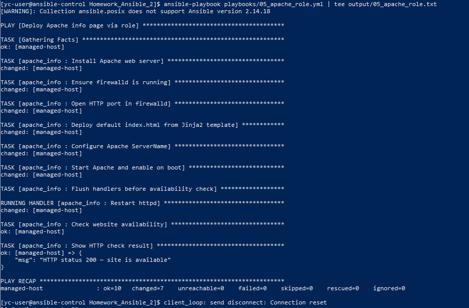
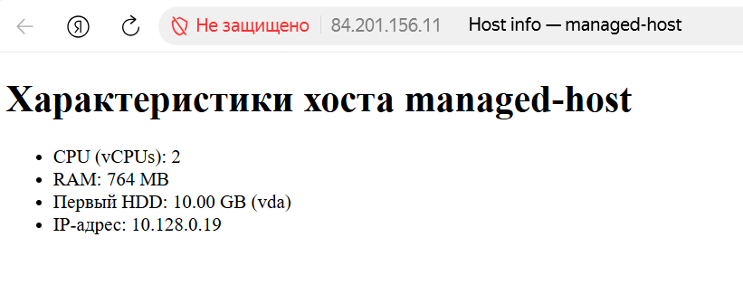

# Домашнее задание к занятию "Ansible. Часть 2" - Соболева Юля

Стенд: 2 ВМ AlmaLinux/Rocky Linux 9 в Yandex Compute Cloud (`ansible-control` + `managed-host`).  
Минимальная конфигурация: Cascade Lake, 2×5% vCPU, HDD 10 ГБ, прерываемая; RAM — 2 ГБ (control) / 1 ГБ (managed).

Инвентарь: [inventory/inventory.ini](inventory/inventory.ini).

---

### Задание 1

Написаны три плейбука для управляемого хоста (`managed`). Запуск с control-ноды:

```bash
ansible-playbook playbooks/01_download_unpack.yml | tee output/01_download_unpack.txt
ansible-playbook playbooks/02_tuned.yml            | tee output/02_tuned.txt
ansible-playbook playbooks/03_motd.yml             | tee output/03_motd.txt
```

1. Плейбук 1 скачивает архив Apache Kafka, создаёт каталог `/opt/kafka` и распаковывает архив (`get_url`, `file`, `unarchive`).
2. Плейбук 2 устанавливает пакет `tuned` через `dnf`, запускает демон и добавляет в автозагрузку (`service`).
3. Плейбук 3 меняет `/etc/motd`; текст задаётся переменной `motd_message`.
4. Файлы плейбуков: [playbooks/01_download_unpack.yml](playbooks/01_download_unpack.yml), [playbooks/02_tuned.yml](playbooks/02_tuned.yml), [playbooks/03_motd.yml](playbooks/03_motd.yml).
5. Вывод выполнения сохраняется в `output/01_download_unpack.txt`, `output/02_tuned.txt`, `output/03_motd.txt` (скриншот ниже).

**Плейбук 1 — скачивание и распаковка архива:**

```yaml
---
- name: Download and unpack archive
  hosts: managed
  become: true
  vars:
    kafka_version: "2.13-3.7.1"
    kafka_archive: "kafka_{{ kafka_version }}.tgz"
    kafka_url: "https://archive.apache.org/dist/kafka/3.7.1/{{ kafka_archive }}"
    kafka_dest_dir: /opt/kafka
    kafka_download_path: "/tmp/{{ kafka_archive }}"

  tasks:
    - name: Create destination directory for unpack
      ansible.builtin.file:
        path: "{{ kafka_dest_dir }}"
        state: directory
        mode: "0755"

    - name: Download Kafka archive
      ansible.builtin.get_url:
        url: "{{ kafka_url }}"
        dest: "{{ kafka_download_path }}"
        mode: "0644"

    - name: Unpack Kafka archive
      ansible.builtin.unarchive:
        src: "{{ kafka_download_path }}"
        dest: "{{ kafka_dest_dir }}"
        remote_src: true
        creates: "{{ kafka_dest_dir }}/kafka_{{ kafka_version }}"
```

**Плейбук 2 — установка и автозапуск tuned:**

```yaml
---
- name: Install and enable tuned
  hosts: managed
  become: true

  tasks:
    - name: Install tuned package
      ansible.builtin.dnf:
        name: tuned
        state: present

    - name: Start tuned and enable on boot
      ansible.builtin.service:
        name: tuned
        state: started
        enabled: true
```

**Плейбук 3 — MOTD через переменную:**

```yaml
---
- name: Change system MOTD using a variable
  hosts: managed
  become: true
  vars:
    motd_message: "Welcome to Ansible managed host!"

  tasks:
    - name: Set /etc/motd from variable
      ansible.builtin.copy:
        content: "{{ motd_message }}\n"
        dest: /etc/motd
        mode: "0644"
```

Скриншот выполнения задания 1:



---

### Задание 2

Модифицирован плейбук из пункта 3 задания 1: в MOTD выводятся IP-адрес и hostname управляемого хоста, а также пожелание хорошего дня системному администратору. IP берётся из facts (`ansible_default_ipv4.address`).

1. Файл: [playbooks/04_motd_facts.yml](playbooks/04_motd_facts.yml).
2. Запуск: `ansible-playbook playbooks/04_motd_facts.yml | tee output/04_motd_facts.txt`.
3. Проверка: `ssh yc-user@10.128.0.19` — при входе видно новое приветствие.
4. Вывод выполнения: `output/04_motd_facts.txt` (скриншот ниже).

```yaml
---
- name: Set MOTD with IP, hostname and greeting
  hosts: managed
  become: true

  tasks:
    - name: Resolve host IP for MOTD
      ansible.builtin.set_fact:
        motd_ip: "{{ ansible_default_ipv4.address }}"

    - name: Set MOTD with host facts
      ansible.builtin.copy:
        content: |
          Hostname: {{ ansible_hostname }}
          IP address: {{ motd_ip }}
          Хорошего дня, системный администратор!
        dest: /etc/motd
        mode: "0644"
```

Скриншот выполнения задания 2:



---

### Задание 3

Создана роль `apache_info` и плейбук, который её подключает. Модули `shell` / `command` не используются (пакеты — `dnf`, файлы — `template`/`lineinfile`, сервис — `service`, проверка — `uri`, firewall — `ansible.posix.firewalld`).

1. Роль: [roles/apache_info/](roles/apache_info/) — установка Apache (`httpd`), Jinja2 `index.html` с CPU/RAM/HDD/IP из Ansible facts, handler перезапуска `httpd` только при изменении `httpd.conf` (`ServerName`), открытие порта 80, автозапуск, проверка HTTP 200.
2. Плейбук: [playbooks/05_apache_role.yml](playbooks/05_apache_role.yml).
3. Запуск: `ansible-playbook playbooks/05_apache_role.yml | tee output/05_apache_role.txt`.
4. Архив роли: `cd roles && tar -czvf apache_info.tar.gz apache_info` → [roles/apache_info.tar.gz](roles/apache_info.tar.gz).
5. Проверка в браузере с ПК: `http://84.201.156.11/`.

**Плейбук:**

```yaml
---
- name: Deploy Apache info page via role
  hosts: managed
  become: true
  roles:
    - apache_info
```

**Роль — tasks/main.yml:**

```yaml
---
- name: Install Apache web server
  ansible.builtin.dnf:
    name:
      - "{{ apache_package }}"
      - firewalld
    state: present

- name: Ensure firewalld is running
  ansible.builtin.service:
    name: firewalld
    state: started
    enabled: true

- name: Open HTTP port in firewalld
  ansible.posix.firewalld:
    port: "{{ apache_listen_port }}/tcp"
    permanent: true
    immediate: true
    state: enabled

- name: Deploy default index.html from Jinja2 template
  ansible.builtin.template:
    src: index.html.j2
    dest: "{{ apache_index_path }}"
    mode: "0644"

- name: Configure Apache ServerName
  ansible.builtin.lineinfile:
    path: /etc/httpd/conf/httpd.conf
    regexp: '^#?ServerName '
    line: "ServerName {{ apache_server_name }}"
    state: present
  notify: Restart httpd

- name: Start Apache and enable on boot
  ansible.builtin.service:
    name: "{{ apache_service }}"
    state: started
    enabled: true

- name: Flush handlers before availability check
  ansible.builtin.meta: flush_handlers

- name: Check website availability
  ansible.builtin.uri:
    url: "http://127.0.0.1/"
    status_code: 200
  register: website_check
  changed_when: false

- name: Show HTTP check result
  ansible.builtin.debug:
    msg: "HTTP status {{ website_check.status }} — site is available"
```

**Роль — handlers/main.yml:**

```yaml
---
- name: Restart httpd
  ansible.builtin.service:
    name: "{{ apache_service }}"
    state: restarted
```

**Роль — templates/index.html.j2:**

```html
<!DOCTYPE html>
<html lang="ru">
<head>
  <meta charset="utf-8">
  <title>Host info — {{ ansible_hostname }}</title>
</head>
<body>
  <h1>Характеристики хоста {{ ansible_hostname }}</h1>
  
  <ul>
    <li>CPU (vCPUs): {{ ansible_processor_vcpus }}</li>
    <li>RAM: {{ ansible_memtotal_mb }} MB</li>
    <li>Первый HDD: {{ ansible_devices[disk_names[0]].size }} ({{ disk_names[0] }})N/A</li>
    <li>IP-адрес: {{ ansible_default_ipv4.address }}</li>
  </ul>
</body>
</html>
```

Скриншоты выполнения задания 3:




